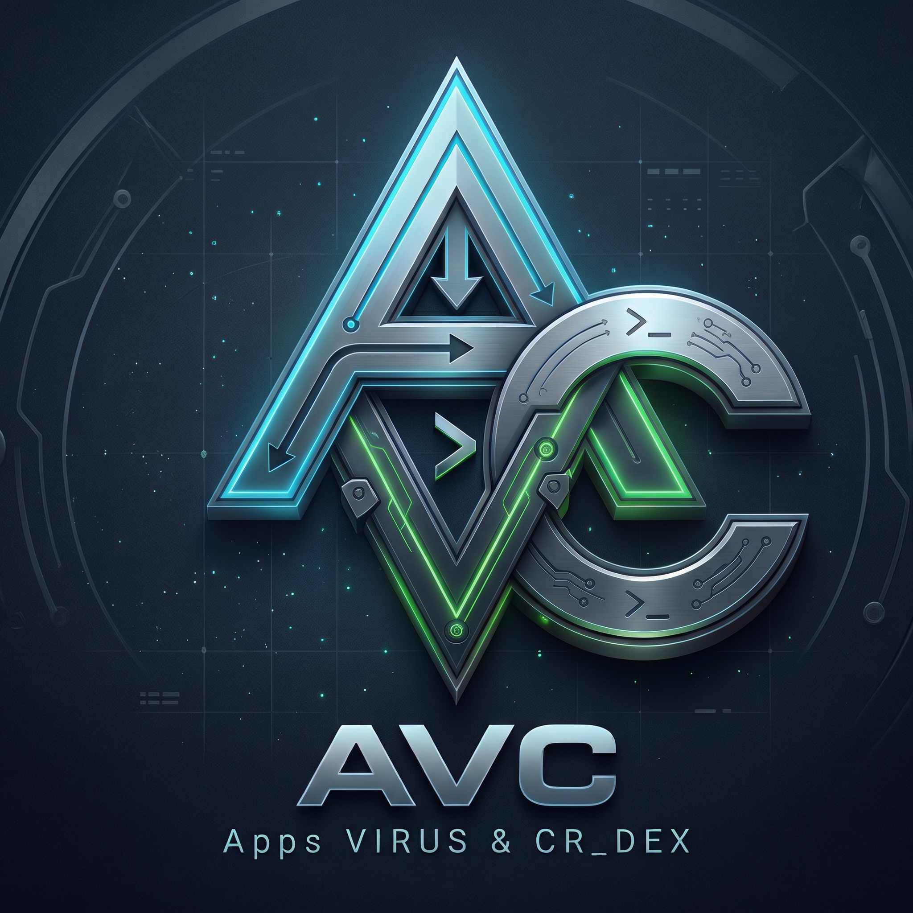

# AVC UI
The better alternative to deb
fast build - fast get - fast share

---

### Developers
**VIRUS & CR_DEX**
AVC solve problems of deb
1. easy to build App
2. easy to install without errors
3. easy to share ( free - paid for you )
4. less space - less RAM - more stable
5. auto security & encryption
6. ENV command line (work with avcui)
---

### Commands

let a Name’s Project is ( test )

🚀 `init test` => Create new tree for test project

🧱 `build test` Build project to `.avc`

| `install <file.avc>` | Install local package |
| `uninstall <name>` | Remove installed package |
| `list` | Show installed packages |
| `zip2avc <file.zip>` | Convert zipapp to `.avc` |
| `hub` / `search` | Browse packages on the hub |
| `get <name>` | Download & install from hub |
| `version` | Show AVC version |
| `help` | Show help |

### AVCUI Shell

| Command | Description |
|---------|-------------|
| `cd` / `pwd` / `ls` / `ll` | Navigation & listing |
| `clear` / `cl` / `c` | Clear screen |
| `ch` | `chmod +x` all files in current dir |
| `exit` / `quit` | Leave AVCUI |

---

**Shared folder:** `~/AVCUI` (bridge between Termux and AVCUI)
